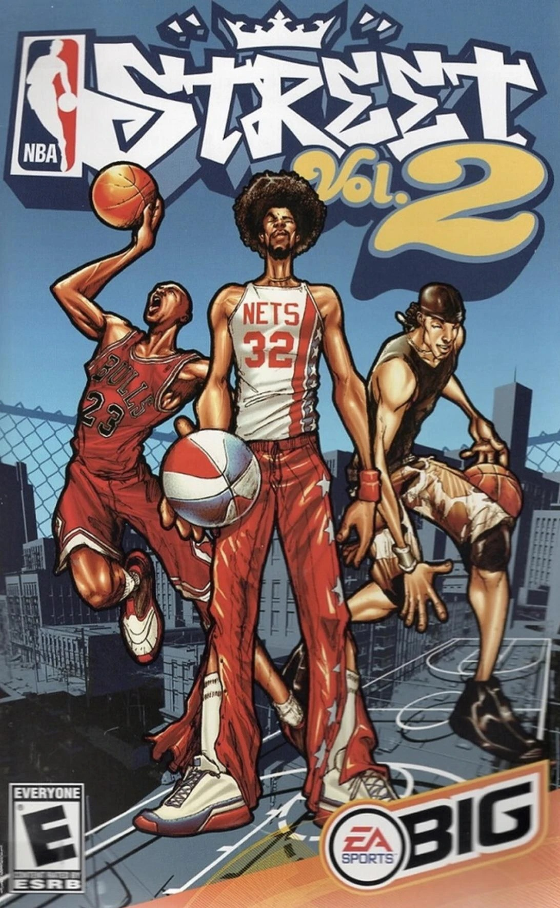

# Quest 3 Streets

NBA Street Vol. 2 (GameCube) on a Meta Quest 3: a giant screen floating in your room, or the same
screen in VR. It runs on the headset by itself, no PC needed to play.

Built on [DolphinXR](https://github.com/iChris4/DolphinXR), iChris4's Quest build of the
[Dolphin](https://github.com/dolphin-emu/dolphin) emulator, with a layer made for this one game.

*You need your own copy of the game. **No game files are included**, in this repository or in the
APK.*

### [⬇ Download the latest version](https://github.com/LanceSweatpants/Quest-3-Streets/releases/latest)

On that page, under **Assets**, get the file ending in **`.apk`** (not "Source code"). Then follow
[How to install](#how-to-install-easy-version).

## What it is

- **The big screen in your room (MR)**: the game on a giant screen floating in your real room. Grab
  it, move it, resize it, three preset sizes.
- **The big screen in VR**: the same screen with a color gradient all around you: midnight,
  sunset, ocean, purple, mint, fire or gray (**VR background** on the first screen).
- **One button for shooting and blocking**: B shoots when your team has the ball and blocks when the
  other team has it.

**Coming soon:** online 1v1 with voice chat, a 3D stadium around you in VR, and the tabletop mode
(the court as a 3D miniature on your real table).

## Status

**Free alpha.** Tested on Quest 3 and Quest 3S. Expect rough edges, and see
[Known issues](#known-issues).

## How to install (easy version)

**You need:**
- A **Meta Quest 3 or 3S** and a **USB-C cable**
- A **PC**
- **Your own** NBA Street Vol. 2 (GameCube, **USA**) game file: `.rvz`, `.iso`, `.gcm`, `.ciso`,
  `.gcz` or `.wia`

### Step 1 · Developer Mode *(only once)*
1. On your phone, open the **Meta Horizon** app.
2. **Devices** → your Quest → **Headset settings** → **Developer mode** → **On**.
   *(Asked to make a free developer account? Do it, then come back.)*
3. Restart the Quest.

### Step 2 · SideQuest *(only once)*
1. On your PC, install the free [**SideQuest Advanced Installer**](https://sidequestvr.com/setup-howto) and open it.
2. Plug the Quest into the PC.
3. Put the Quest on. At **"Allow USB debugging?"** tick **Always allow** and press **Allow**.
4. The dot at the top left of SideQuest turns **green**. You're connected.

### Step 3 · The app
1. [**Download the `.apk`**](../../releases/latest): under **Assets**, the file ending in `.apk`.
2. Drag it onto the SideQuest window. Wait until it says it's done.

### Step 4 · Your game file
1. In SideQuest, click the **folder icon** at the top.
2. Open **Download**.
3. Drag your game file in. *(Zipped? Unzip it first.)*

### Step 5 · Play
1. Unplug the Quest and put it on.
2. **Library** → **All** (top right) → **Unknown Sources** → **Quest 3 Streets**.
3. **First time only:** press **Choose game file**. The app asks for **"Allow access to manage all
   files"**: press **Open the setting**, turn it on, and come back. It lists the GameCube game files
   on your Quest; tap your NBA Street Vol. 2 file. The app plays it from where it is (no copy).
4. Press **Play**.

## Controls (Quest controllers)

### Playing

| Button | What it does |
| --- | --- |
| **Left stick** | Move |
| **A** | Pass / switch player |
| **B** | Shoot on offense, block on defense |
| **Both grips** (squeeze together) | **GAMEBREAKER** (when your Gamebreaker meter is full) |
| **Right grip** (squeeze) | Trick / steal (the GameCube's X) |
| **Left grip** (squeeze) | The GameCube's Z (extra trick button) |
| **X** or **Y** (left controller) | The GameCube's Y |
| **Left / right trigger** | Turbo (the GameCube's L / R) |
| **Right stick** | The GameCube's C-stick |
| **Menu button** (left controller, ☰) | Pause |

### The view

"Click" a stick means **press it straight down** like a button.

| Do this | What happens |
| --- | --- |
| **Left stick: click twice fast** | Swap between **your room** (mixed reality) and **VR** |
| **Right stick: click once** | Next screen size |
| **Left stick: click once** | Bring the screen back in front of you |
| **Left grip** while pointing the left controller at the screen | Grab the screen and move it |
| **Both grips** while holding it | Pull apart or together to resize, twist to turn |

The screen's place is remembered, one for your room and one for VR.

## If something goes wrong

- **SideQuest says "there's no apk in that file":** you downloaded "Source code". On the
  [Releases page](../../releases/latest), under **Assets**, download the file ending in **`.apk`**.
- **"No game file found on this Quest":** put the file in the Quest's **Download** folder with
  SideQuest (Step 4), then press **Look again**.
- **Your file is greyed out in the list:** the app only plays the USA GameCube version of NBA Street
  Vol. 2. Other versions or a broken file can't be picked.
- **Still stuck?** [Report a bug](../../issues/new).

## Known issues

- **Online play, the VR stadium and the tabletop mode aren't in this release yet.** They're coming.
- **The headset stays at 72 Hz** while the game runs at 60 fps, so the picture isn't perfectly even.
  The app asks the Quest for 120 Hz; the Quest hasn't granted it yet.

## Building from source

Most players don't need this. This is DolphinXR's Android build with this project's changes:

- Android SDK with NDK **29.0.14206865**, JDK 17, CMake 3.22+.
- From `Source/Android`: `./gradlew :app:assembleQuestDebug -PstreetPublic=true "-PstreetAppName=Quest 3 Streets"`
  (→ `app/build/outputs/apk/quest/debug/app-quest-debug.apk`).
- Without `-PstreetPublic=true` you get the developer build (tabletop mode, online play and dev
  tools on, a different app id).

Where this project's code lives:

- `Source/Core/VideoCommon/VR/HitzWorld.cpp`, `HitzModes.cpp`: the view modes, the screen, the VR
  backgrounds.
- `Source/Core/VideoBackends/OGL/OGLOpenXR.cpp`: the VR backgrounds as cube layers.
- `Tools/StreetMR-Vegas/`: Blender scripts for a VR stadium (work in progress, not in releases).
- `Source/Core/Core/HitzDev.cpp`: the shoot / block button.
- `Source/Android/app/.../street/`: the start screen and the game file picker.
- `Source/Android/jni/StreetOnline.cpp`, `StreetVoice.cpp`: online play and voice chat (in progress,
  switched off in releases).

## Credits

- The [Dolphin](https://dolphin-emu.org) team: the emulator.
- [iChris4](https://github.com/iChris4): DolphinXR, the OpenXR / Quest build of Dolphin this is
  built on.
- Quest port and view modes: [LanceSweatpants](https://github.com/LanceSweatpants).

## License

**GNU General Public License, version 2 or (at your option) any later version**, like Dolphin; the
text is in [`COPYING`](COPYING). Third-party code under `Externals/` keeps its own license (each
folder has its license file); see [`THIRD-PARTY-NOTICES.md`](THIRD-PARTY-NOTICES.md).

## Disclaimer

An unofficial fan project, not affiliated with or endorsed by Electronic Arts or the NBA. NBA Street
is a trademark of its owners. No game files are included in this repository or in the APK; the game
runs only from a disc image of your own, legally obtained copy.
